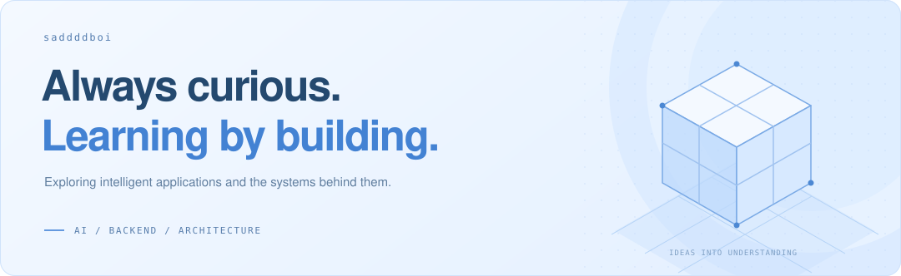

  

  <strong>AI learner &nbsp; · &nbsp; Backend development learner &nbsp; · &nbsp; Architecture learner</strong>

  I read source, build small systems, and learn from what breaks.

 

### What I'm exploring

**AI applications** &nbsp; Agents, tools, memory, and context. Understanding how useful workflows come together.

**Backend development** &nbsp; APIs, databases, caches, and messaging. Following a request all the way through.

**Software architecture** &nbsp; Boundaries, consistency, and recovery. Learning to make trade-offs explicit.

 

### My learning toolkit

`Java` `Python` `Spring Boot` `FastAPI` &nbsp; / &nbsp; `MySQL` `PostgreSQL` `Redis`

`Kafka` `RocketMQ` `Docker` &nbsp; / &nbsp; `LangChain` `LangGraph` `MCP`

 

### Open-source contributions

**[DeerFlow](https://github.com/bytedance/deer-flow) · Open-source contributor**

Fixed cross-conversation starvation in background memory extraction, with
per-conversation deadlines and regression tests.

↗ **[PR #6672 — merged](https://github.com/bytedance/deer-flow/pull/6672)**

 

---

  Still learning. Always building. 
  <a href="https://github.com/search?q=is%3Apr+author%3Asaddddboi+is%3Amerged&type=pullrequests">Contributions</a>
  &nbsp; · &nbsp;
  <a href="https://github.com/saddddboi?tab=repositories">Repositories</a>

